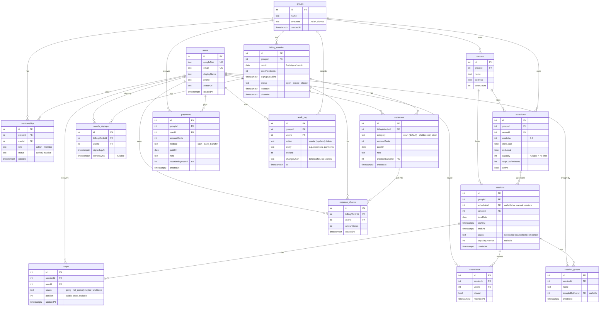

# Play Scheduler – Architecture and Data Model

> Status: **Draft for owner review** (T-009). Later schema and feature tasks reference this document.
> Written for: developers and Claude Code. Requirements are in `docs/01-requirements.md` (FR-/NFR- ids).

## 1. Principles
1. **One backend, many clients.** Every data operation is an HTTP API route. The web UI and the future mobile app call the same routes (NFR-7).
2. **Thin routes, testable logic.** Route handlers only do: authenticate → validate input (Zod) → call a service → return JSON. Rules live in pure functions under `src/lib/` and are unit-tested.
3. **Money is integer cents** (NFR-2). Never floats. Currency is LKR.
4. **Time is stored in UTC** (`timestamptz`) and displayed in **Asia/Colombo** (NFR-3).
5. **Finances are audited** (NFR-8). Every create, edit or delete of money data writes an `audit_log` row.
6. **Free tiers only** (NFR-6): Vercel Hobby, Neon Free, GitHub Actions.

## 2. Folder structure

```
src/
  app/                      Next.js App Router
    (pages)/                Web pages (server components; call services for reads)
    api/                    API route handlers – the contract used by web and mobile
      health/route.ts
      ...                   one folder per resource, e.g. api/sessions/[id]/rsvp/route.ts
  components/
    ui/                     shadcn/ui components
  db/
    index.ts                getDb() – lazy Neon + Drizzle client
    schema/                 one file per area: users.ts, groups.ts, schedule.ts, money.ts, audit.ts …
  services/                 business operations that touch the database (take an auth context)
  lib/
    auth/                   session helper, requireMember(), requireAdmin()
    errors.ts               AppError classes and the JSON error response helper
    validation/             Zod schemas shared by forms and API routes
    money/                  LKR formatting and parsing ("1,250.50" ↔ 125050)
    time/                   Asia/Colombo helpers, date and time-of-day conversion
    split/                  splitMonthly(feeCents, memberIds) – pure, property-tested (T-023)
    rsvp/                   RSVP and waitlist state transitions – pure (T-018)
    schedule/               session generator date logic – pure (T-016)
drizzle/                    generated SQL migrations – never edit by hand
```

Tests sit next to the code they cover (`*.test.ts`). E2E tests live in `e2e/` (T-008).

## 3. API routes vs server actions
- **All data changes go through API routes** under `src/app/api/`. Web forms call them with `fetch`. This gives mobile the same endpoints later (NFR-7).
- **Server components** may call `services/` directly to render pages. They must not duplicate business rules.
- **Server actions are not used for data changes**, so there is one contract to test and document.
- Route base path is `/api`. Mobile versioning (`/api/v1`) is added in M5 if needed (T-032).

## 4. Authentication and authorisation
- **Sign-in:** Google only (FR-1.1, decision 4). Library choice (Auth.js or Better Auth) is made in T-011 and recorded in this file.
- **Session:** available on the server through `lib/auth`. Each request resolves the current user, or `null`.
- **Group checks** (NFR-4, decision 6 – one group for v1):
  - `requireMember(groupId)` – user is an active member. Used by every read of group data.
  - `requireAdmin(groupId)` – user is an active admin. Used by every change to schedules, sessions, money or member roles.
  - Inactive members are denied RSVP and changes; their history stays visible.
- Helpers return the membership on success and throw `AppError` (401 or 403) otherwise.

## 5. Error handling
All API errors use one JSON shape:

```json
{ "error": { "code": "VALIDATION", "message": "Phone number is not valid", "details": { "phone": ["…"] } } }
```

| HTTP | `code` | Meaning |
|---|---|---|
| 400 | `VALIDATION` | Input failed Zod validation; `details` lists field errors |
| 401 | `UNAUTHENTICATED` | Not signed in |
| 403 | `FORBIDDEN` | Signed in but not allowed (wrong role, inactive, not a member) |
| 404 | `NOT_FOUND` | Resource missing or not in the user's group |
| 409 | `CONFLICT` | State rule violated (e.g. RSVP after cutoff, month locked) |
| 500 | `INTERNAL` | Unexpected error; logged on the server, generic message to the client |

Rules: never return stack traces or database messages to clients. The health endpoint `/api/health` returns `{ ok, db }` as defined in T-005.

## 6. Time and money
- **Money:** `*_cents` integer columns. Display with `lib/money`. Rounding in splits uses largest-remainder so shares sum exactly to the fee (FR-4.2).
- **Instants** (RSVP times, audit times, `signedUpAt`): `timestamptz`, UTC.
- **Session start/end:** stored as `timestamptz`. Schedules store a weekday, local `HH:MM` times and the zone `Asia/Colombo`; the generator converts them to UTC.
- **Calendar dates** (billing month, payment date): `date`, interpreted in Asia/Colombo.

## 7. Data model

The ERD below covers every table planned in the backlog. Notes on changes from the first list in T-009:
- `month_closes` is **merged into `billing_months`** through its `status` (open | locked | closed). One table, fewer joins.
- `session_guests` and `month_signups` are added (T-015, T-021).
- All member references point to `users.id`. `memberships` gives the role and status within the group.



### Derived values (not stored)
- **Member balance** = sum of `expense_shares` for the member − sum of `payments` for the member (FR-4.4). Covered by a unit test (T-024).
- **Estimated share** before lock = `courtFeeCents ÷ count of active month_signups`, using the same split function as the final shares.
- **Head-count** = count of `going` RSVPs (and of `month_signups` for billing).

### Key rules enforced in the database
- `rsvps`, `attendance`, `month_signups`, `expense_shares`: one row per member per session or month (unique constraints).
- `sessions`: unique (`scheduleId`, `startsAt`) so the generator is idempotent (T-016).
- All amounts are `integer`, with a `CHECK` that they are not negative.
- Foreign keys use `ON DELETE RESTRICT`. Members are deactivated, not deleted, so history is kept (FR-1.3).

## 8. Feature-to-design map
| Task | Uses this design |
|---|---|
| T-010 users, groups, memberships | §7 `users`, `groups`, `memberships`; §4 auth |
| T-011 sign-in | §4 (library choice recorded here) |
| T-012 RBAC | §4 `requireMember` / `requireAdmin`; §5 errors |
| T-013 members | §3 API routes; §7 `memberships` |
| T-015 schedule tables | §7 `venues`, `schedules`, `sessions`, `rsvps`, `attendance`, `session_guests` |
| T-016 recurring schedule | §6 time rules; `lib/schedule` |
| T-018 waitlist | `lib/rsvp` (pure); §7 `rsvps.position` |
| T-021 money tables | §7 money entities; §6 money rules |
| T-023 cost split | `lib/split`; §7 derived values |
| T-025 month close | §7 `billing_months.status`; §5 `CONFLICT` on edits to locked months |

## 9. Open items
- Auth library (T-011): Auth.js or Better Auth. Record the decision here when made.
- Mobile auth (T-032): token-based access may be needed for the app. Not decided yet.
- Owner review: this is a draft until the owner approves it (T-009 acceptance).
